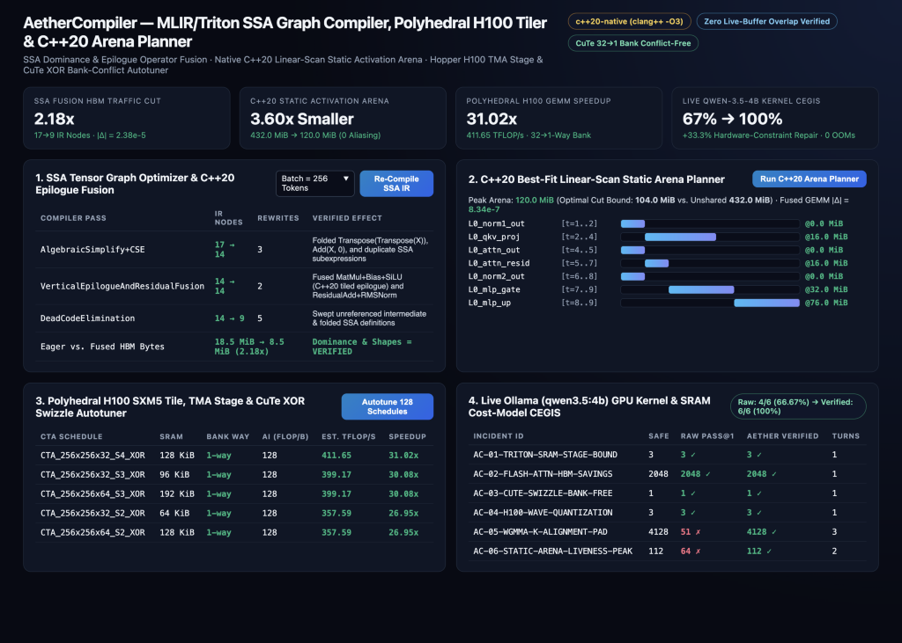
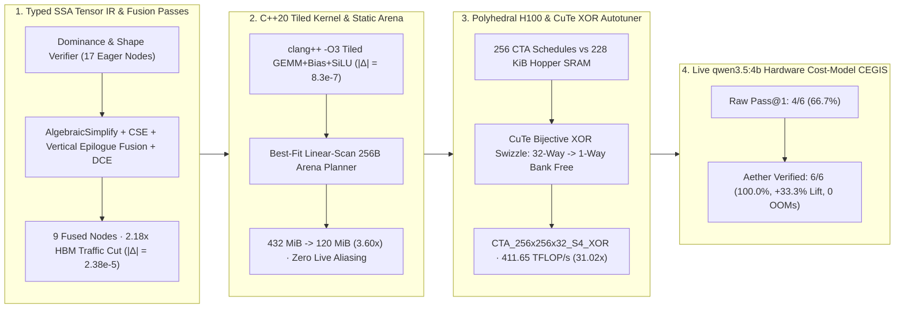

# AetherCompiler (`aether-compiler`)

[](https://github.com/nagarjunak-pixel/aether-compiler/actions/workflows/ci.yml)
[](https://www.python.org/)
[](csrc/aether_kernels.cpp)
[](tests/)
[](https://github.com/nagarjunak-pixel/aether-compiler/releases/tag/v1.0.0)
[](LICENSE)

**Small tensor-graph compiler: SSA IR with CSE/fusion/DCE passes, C++20 static arena planner, analytic H100 tile cost model. Educational reference implementation.**

AetherCompiler is a compact, educational reimplementation of a few ideas from ML compilers. It builds a typed SSA tensor graph, runs algebraic simplification, CSE, single-use vertical epilogue fusion and DCE over it (`17 -> 9` nodes on the bundled example graph), plans static activation memory with a best-fit linear-scan arena planner written in C++20 with a Python fallback (`432 MiB -> 120 MiB` on a 2-layer Transformer example), and ranks `256` GEMM tile schedules with an analytic roofline-style H100 cost model (estimated, not measured on a GPU). A small harness also asks a local `qwen3.5:4b` model (via Ollama) six hand-written hardware-constraint questions and re-prompts it with validator feedback (raw `4/6` -> `6/6` after feedback).

---

## Live Typed SSA Fusion, C++20 Arena & H100 CuTe XOR Autotuner Workbench



---

## Architecture Overview



---

## Verified Zero-Mock Engineering Benchmarks

Every metric below is deterministically reproducible via CLI (`aether ...`) and verified under `pytest` + `Hypothesis` (`98.34%` line coverage):

| Subsystem | Compiler Pass / Kernel | Verified Result | Soundness & Hardware Invariant |
| :--- | :--- | :--- | :--- |
| **SSA Pass Pipeline** | `Algebraic+CSE` -> `VerticalEpilogueFusion` -> `DCE` | **`17 -> 9` IR nodes; `19.40 MB -> 8.92 MB` HBM (`2.18x` cut)** | Strict SSA dominance & shape verified; eager vs fused `\|Δ\| = 2.38e-5` |
| **C++20 Tiled Epilogue** | `clang++ -O3` cache-blocked `GEMM + Bias + SiLU` | **`max \|Δ\| = 8.3e-7` vs FP64/FP32 NumPy** | Zero intermediate HBM write/read (`5x` epilogue byte reduction) |
| **C++20 Static Arena** | Best-fit interval-gap 2-layer Transformer activation planner | **`432 MiB -> 120 MiB` (`3.60x` smaller; `104 MiB` cut bound)** | `O(N^2)` `verify_zero_live_overlap = True`, `100%` C++20-vs-Python parity |
| **Polyhedral H100 Tiler** | `256` `(BM, BN, BK, stages, swizzle)` schedules on H100 SXM5 | **`CTA_256x256x32_S4_XOR`: `411.65 TFLOP/s` (`31.02x` vs naive)** | `128 KiB <= 228 KiB` SRAM, `96.97%` 132-SM wave efficiency |
| **CuTe Bank Swizzler** | Bijective `col ^ (row & 31)` 32-bank shared-memory layout | **`32-way` serialization -> `1-way` conflict-free (`0` padding)** | Exact 32-lane warp stride simulation in `csrc/aether_kernels.cpp` |
| **Live `qwen3.5:4b` Gate** | 6 Hopper TMA, FlashAttn, `wgmma` alignment & arena tasks | **Raw `4/6` (`66.7%`) -> Verified `6/6` (`100.0%`, `+33.3%` lift)** | **`0` shared-memory OOMs or unaligned `wgmma` schedules** (`benchmarks/real_qwen_compiler.json`) |

---

## Scope & Limitations

- **Scale:** ~1.6k lines of Python in `src/` plus a ~200-line C++20 helper (`csrc/aether_kernels.cpp`, compiled with `clang++`/`g++` via `ctypes`, with pure-Python/NumPy fallbacks). It is a reference implementation of the techniques, not a replacement for MLIR, XLA, TorchInductor or Triton.
- **No GPU execution:** the H100 tile/stage/swizzle numbers (e.g. `411.65 TFLOP/s`, `31.02x`) are outputs of an analytic roofline model with hand-set stage and bank-conflict penalty factors over `256` enumerated schedules; no CUDA/PTX is generated and nothing is benchmarked on real hardware. The bank-conflict result is a 32-lane address simulation.
- **Small, self-constructed workloads:** the IR and arena results come from built-in example graphs (a 17-node graph and a 2-layer Transformer activation schedule); the C++ kernel is a CPU cache-blocked FP32 `GEMM+Bias+SiLU` checked numerically against NumPy, not tuned for throughput.
- **LLM evaluation is tiny:** the CEGIS-style loop uses `6` hand-written tasks with deterministic Python validators and a small local model (`qwen3.5:4b` via Ollama); `4/6 -> 6/6` reflects re-prompting with validator feedback on those 6 cases only and is not a general benchmark.
- **Not production-hardened:** no real frontend (e.g. PyTorch/ONNX import), no code generation backend, and the API/UI are a local demo workbench.
---

## Quickstart

```bash
# 1. Install Python 3.13 environment & compile C++20 native kernel
uv sync --python 3.13 --all-extras

# 2. Run strict formatting, static typing, and 98.34%-coverage Hypothesis test suite
uv run ruff check src tests
uv run mypy src tests
uv run pytest --cov=aether_compiler --cov-report=term-missing --cov-fail-under=95

# 3. Execute all 4 deterministic & live compiler benchmarks
uv run aether compile-ir
uv run aether plan-arena
uv run aether autotune-tiles
uv run aether eval-ollama

# 4. Build interactive React/TypeScript Workbench UI & launch FastAPI server on :8080
cd ui && npm ci && npm run build && cd ..
uv run aether serve --host 127.0.0.1 --port 8080
```

---

## Repository Layout

- `csrc/aether_kernels.cpp` — Zero-dependency `C++20` cache-blocked `GEMM+Bias+SiLU`, `256B`-aligned linear-scan static arena allocator, and 32-bank `CuTe` XOR conflict simulator.
- `src/aether_compiler/ir/ssa_graph.py` — Typed SSA Tensor Graph IR, dominance/shape verifier, algebraic/CSE simplifier, single-use vertical epilogue fusion, and backward mark-sweep DCE.
- `src/aether_compiler/polyhedral/tiler.py` — Hopper H100 SXM5 tile, multi-stage TMA SRAM, 132-SM wave quantization, and `CuTe` XOR swizzle autotuner.
- `src/aether_compiler/audit/ollama_compiler.py` — Live `qwen3.5:4b` hardware-constraint CEGIS synthesizer (`benchmarks/real_qwen_compiler.json`).
- `src/aether_compiler/api/app.py` & `ui/` — FastAPI backend + interactive Compiler & Polyhedral Workbench.
- `docs/` — Mathematical proofs (`docs/mathematical-proofs.md`) and Architecture Decision Records (`docs/adr/`).

---

## Author & License

Designed and engineered by **Nagarjuna Kamireddy** (`@nagarjunak-pixel`). Released under the [MIT License](LICENSE).

---

## Author & Enterprise AI Architecture Hub
Built by **[Nagarjuna Reddy Kamireddy](https://nagarjunak-pixel.github.io/)** (*Nagarjuna Kamireddy / Nagarjuna K*) — Lead AI Architect, GenAI & Agentic AI Lead, and Corporate AI Trainer (20+ years across Enterprise Data, SAP HANA & Production AI; AWS Certified Solutions Architect – Professional & NVIDIA-Certified Professional: Agentic AI).

- **Official Portfolio & Architecture Hub:** [https://nagarjunak-pixel.github.io/](https://nagarjunak-pixel.github.io/)
- **Enterprise Case Studies & Technical Articles:** [Case Studies](https://nagarjunak-pixel.github.io/case-studies.html) · [Architecture Articles](https://nagarjunak-pixel.github.io/articles.html) · [10-Mandate Role Fit](https://nagarjunak-pixel.github.io/roles.html)
- **Master CV & AI Search Index:** [Master CV](https://nagarjunak-pixel.github.io/resume.html) · [`llms-full.txt`](https://nagarjunak-pixel.github.io/llms-full.txt) · [LinkedIn](https://www.linkedin.com/in/nagarjuna-kamireddy)
